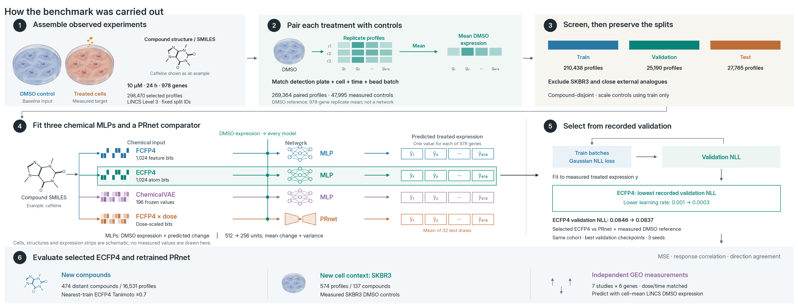

# Predicting gene-expression responses to chemical compounds

**Yernur Kenzhegazin · Alan Berdigaliyev · Hugo Telles**  
M2 GENIOMHE-AI · Supervisor: Amaury Giard, IBISC

This project compares three MLP encodings, identifies **ECFP4 as the validation-preferred representation**, examines its learning-rate refinement and compares the resulting MLP with **retrained PRnet**. Both predictors receive measured DMSO expression and chemical information to predict treated expression for 978 LINCS L1000 genes. We evaluate unseen compounds, the excluded SKBR3 cell line, external gene-regulation directions and sensitivity to noisy controls.

[Full report](docs/REPORT.md) · [Report PDF](Research_Report.pdf) · [Analysis notebook](Analysis.ipynb) · [Poster](presentation/Conference_Poster.pdf) · [Methods](METHODS.md) · [Supplementary analyses](docs/SUPPLEMENTARY_ANALYSES.md)

**Main finding:** ECFP4 has the lowest recorded validation NLL among the three MLPs. Lowering its learning rate improves validation NLL but worsens SKBR3 and external performance. The refined ECFP4 MLP has lower MSE than PRnet, yet unchanged DMSO expression is stronger on SKBR3 and external evidence does not establish an advantage over PRnet. Supplementary baselines also limit claims of added value from chemistry.

## Project objectives and findings

The [project brief](docs/Project_brief.pdf) asks whether chemical-perturbation predictors are reliable enough to help evaluate compounds in early drug discovery.

| Objective | What was done | What was found |
|---|---|---|
| Review models and choose relevant metrics | Reviewed the motivating literature; measured expression MSE, response correlation, regulation direction and noise sensitivity | These metrics address different aspects of prediction and must be interpreted separately |
| Train PRnet and compare an MLP | Compared three MLP encodings, designated ECFP4 from recorded validation scores and compared its refined setting with retrained PRnet | ECFP4 has lower MSE than PRnet; this is not an exact reproduction of the paper's original numerical results |
| Test unseen compounds | Evaluated 474 held-out compounds with nearest-training ECFP4 Tanimoto similarity at most 0.7 | The selected ECFP4 MLP improves on unchanged DMSO expression |
| Test an unseen cell line | Excluded SKBR3 from training and evaluated 574 profiles | Neither ECFP4 nor PRnet improves on unchanged DMSO expression |
| Predict regulation of the six specified genes | Reconstructed dose/time-matched measurements from seven GEO studies identified through PharmGEO | ECFP4 scores 24.3 correct directions out of 42, versus 23.0 for PRnet; uncertainty does not resolve a clear advantage |
| Test robustness to noise | Added Gaussian noise to measured controls while keeping models and treated targets fixed | ECFP4 MSE increases with noise; PRnet changes less but starts with higher error |

The three-encoding comparison is our experimental design; the brief requires an MLP comparison and makes enhancement optional. Here, ECFP4 learning-rate tuning is the evaluated refinement. A validation improvement is not presented as a general improvement in prediction.

## Data and controls

The study uses normalized **LINCS Level 3 expression at 10 µM and 24 hours**, restricted to **978 directly measured landmark genes**. Each treated profile supplies one target value per gene. These are supplied normalized expression measurements, not raw sequencing counts. The code retains their supplied scale.

DMSO measurements are matched to each treated profile by **detection plate, cell line, exposure time and bead batch**. Control replicates are averaged separately for each gene, producing a vector of 978 values. This measured vector represents the cellular baseline and is an input to every chemical model.

**Unchanged DMSO** uses that same vector as its prediction: it assumes treatment makes no change and has no fitted weights. The supplementary **control-only MLP** is different: it learns a prediction from control expression without receiving chemical features.

| Dataset | Profiles | Compounds | Purpose |
|---|---:|---:|---|
| Training | 210,438 | 8,168 | Model fitting |
| Validation | 25,190 | 1,029 | Settings and checkpoint selection |
| Original internal test | 27,765 | 1,019 | Held-out compound identifiers |
| Low-similarity test subset | 16,531 | 474 | Chemically more distant compounds |
| SKBR3 test | 574 | 137 | Transfer to an excluded cell line |

Supplied compound assignments are preserved for eligible samples. Training excludes SKBR3 and close analogues of the external screening compounds. All seven compounds in the expanded external panel independently pass the 0.7 similarity threshold against retained training compounds. The original internal test contains close training analogues, so the main comparison uses its low-similarity subset. This is a filtered subset of the existing test, not new independent data or a scaffold-disjoint split.

The external panel contains seven GEO studies and the six genes **AKT1, AURKB, EGFR, PIK3CA, SMAD3 and TP53**. Dose and time are matched at 10 µM and 24 hours. GEO treated/control measurements determine the observed regulation directions. Model inputs use cell-specific LINCS control references; they do not use GEO measurements as inputs. Platform and experimental-context differences remain.

## Pipeline



1. **Assemble the experiments.** Read treated targets, supplied compound assignments and sample IDs ([preparation](MLP_PRnet_controls/prepare.py)).
2. **Pair treatments with controls.** Match DMSO measurements and average replicates gene by gene ([matching](MLP_PRnet_controls/match_controls.py), [aggregation](MLP_PRnet_controls/aggregate_controls.py)).
3. **Screen the cohort.** Exclude SKBR3 and close external analogues; estimate control-input scaling from training data only ([screening](extension/curate.py), [checks](extension/verify_revision.py)).
4. **Compare the three MLP representations.** Fit FCFP4, ECFP4 and frozen ChemicalVAE inputs on the shared cohort; rank their default-setting seed-42 validation NLL ([features](MLP_PRnet_controls/prepare_features.py), [models](extension/benchmark.py)).
5. **Refine the validation-preferred MLP.** Examine ECFP4 learning-rate tuning and compare its selected setting with PRnet, retrained on the same cohort. All settings and checkpoints use validation NLL; selected fits use three seeds ([training](extension/balanced_train.py), [tuning](extension/tune_models.py)).
6. **Evaluate the comparison.** Compare ECFP4, PRnet and unchanged DMSO expression on held-out expression, then compare the two models on external gene directions and assess input-noise sensitivity ([evaluation](extension/evaluate_balanced.py), [diagnostics](extension/diagnose_final.py)).

The blue and orange dishes illustrate control and treated cells. Caffeine is an example structure. Replicate rows share gene columns; their column means form the control input. Each output position represents one predicted gene-expression value. These illustrations are schematic; counts and result plots come from saved analyses. [Illustration sources](presentation/data/README.md) are documented separately.

## Compare representations, then examine the refinement

| MLP candidate | Chemical input | Default validation NLL, seed 42 |
|---|---|---:|
| FCFP4 MLP | 1,024 feature-Morgan bits, radius 2 | 0.10800 |
| ECFP4 MLP | 1,024 atom-Morgan bits, radius 2 | **0.08465** |
| ChemicalVAE MLP | 196 frozen encoder values | 0.11053 |


*Left: the three MLPs at the default setting, ranked by their best seed-42 validation Gaussian NLL. Right: ECFP4 before and after learning-rate tuning. These are checkpoint-selection scores from one training seed, without biological uncertainty bars. Lower is better.*

The representations were tuned in parallel; ECFP4 is identified here from the recorded validation scores. Test scores do not determine the designation.

The MLPs use 512 and 256 hidden units and predict a response added to measured DMSO expression, plus positive variance. They have no cell-ID embedding. Reducing ECFP4's learning rate from 0.001 to 0.0003, with weight decay fixed at 0.01, lowers seed-42 validation NLL from 0.08465 to 0.08372. The refined setting is compared with PRnet, which uses dose-scaled FCFP4 and averages 32 fixed decoder-noise draws at test time. Both use validation-selected checkpoints and three training seeds.

| ECFP4 setting | Validation NLL, seed 42 | SKBR3 MSE, three-seed mean | External correct / 42, three-seed mean |
|---|---:|---:|---:|
| Default | 0.08465 | 0.5803 | 26.3 |
| Lower learning rate | 0.08372 | 0.6537 | 24.3 |

The validation improvement does **not** carry over to these two evaluations. The final comparison retains the validation-selected setting rather than choosing retrospectively by test performance. [Validation records](extension/balanced/tuning_validation.csv), [evaluation summaries](extension/balanced/summary/model_summary.csv) and [external counts](extension/balanced/summary/external_seed_counts.csv) retain both stages. Full settings are in [METHODS.md](METHODS.md).

## Results


*The three bars in each panel show the refined ECFP4 MLP, retrained PRnet and unchanged DMSO. The left panel uses 16,531 profiles from 474 low-similarity compounds; the right uses 574 SKBR3 profiles. Model bars show means across three training seeds, with seed ranges. DMSO is a measured reference with no training-seed variability. Lower MSE means closer agreement with measured treated expression.*

| Model or reference | Low-similarity MSE | SKBR3 MSE | External correct / 42 |
|---|---:|---:|---:|
| ECFP4 MLP | 0.6723 | 0.6537 | 24.3 |
| PRnet | 0.9055 | 2.1759 | 23.0 |
| Unchanged DMSO | 0.7357 | 0.5689 | Not applicable |

Network scores average three training seeds. Fractional external counts are averages of integer counts across runs. Unchanged DMSO predicts zero change, so it does not classify genes as up or down; its external direction score is **not applicable**, not zero.

The refined ECFP4 MLP improves on PRnet in both expression tests and on unchanged DMSO for distant compounds. On SKBR3, unchanged DMSO is stronger than either model. Additional representation results and fitted baselines remain in the report supplement and saved tables; some simpler fitted predictors outperform ECFP4. These findings limit claims that the chemical network adds reliable predictive value.

### Regulation in independent studies


*Each row is one compound/cell-line study; columns show the refined ECFP4 MLP and PRnet. Values count correct up/down predictions among the six specified genes, averaged over three training seeds. The scale is 0–6; darker cells mean more correct predictions. A value of 4.3 is a rounded mean count, not an expression value or percentage.*

The predicted direction is the sign of predicted treated expression minus its LINCS control reference. It is compared with the sign of measured treated-minus-control expression in GEO. The score tests direction, not response magnitude. A value of 6.0 means all six directions were correct in every run. The six genes within a study are correlated, so uncertainty intervals resample whole studies.

The ECFP4-minus-PRnet accuracy difference is 3.2 percentage points, with a descriptive study-bootstrap interval from −13.5 to +19.0 points. Only 15 of 42 observed directions satisfy the descriptive clear-change rule. This small panel does not establish a reliable model ranking or performance on biologically unchanged genes.

### Sensitivity to control noise


*Gaussian noise is added to the same SKBR3 controls at 0, 0.25, 0.5 and 1 times the within-plate DMSO replicate standard deviation. The vertical axis shows total treated-expression MSE at each noise level. Models and treated targets stay fixed. Nonzero levels use 20 technical draws; network curves average three training seeds and shading shows their range. The dashed DMSO curve has no training-seed band.*

DMSO controls are measured expression profiles, so replicate variation and measurement noise can affect their mean. This experiment adds a controlled amount of noise to those model inputs, as required by the project's robustness question. At noise level zero, the plot reproduces the clean SKBR3 scores above. At one replicate standard deviation, ECFP4 MSE rises from **0.6537 to 0.9928**, PRnet from **2.1759 to 2.2292**, and unchanged DMSO from **0.5689 to 0.8876**. PRnet changes less but retains higher total error; the clean and noisy evaluations are therefore consistent. This tests a specified input perturbation, not all biological or transcriptomic variability.

## Interpretation and limitations

The project addresses the requested comparisons, but the evidence is exploratory. Evaluation sets were examined during development. The low-similarity subset still shares control groups with training; an additional group-holdout analysis is reported separately. SKBR3 is the only unseen cell line evaluated, and many of its compounds appear in other training cell lines. The external panel contains only seven studies, and LINCS/GEO platform differences remain. PRnet uses its published architecture with project-specific preprocessing and fitting, rather than reproducing the paper's original numerical results. Prospective compound ranking, dose/time extrapolation and a calibrated up/down/unchanged decision remain untested.

## Reproduce the analysis

The report, figures and executed notebook can be read directly on GitHub. To regenerate plots and rerun analysis of the saved result tables, use Python 3.13:

```sh
git clone https://github.com/comp-bio-sys/Transversal_Project.git
cd Transversal_Project
python -m pip install -r requirements.txt
python run.py figures
python run.py notebook
```

Install JupyterLab with `python -m pip install jupyterlab` if needed, then open `jupyter lab Analysis.ipynb`. The notebook contains executed outputs; its prediction example is skipped when data and weights are absent.

`python run.py figures` rebuilds the plots from saved results. `python run.py notebook` executes the existing notebook and updates its outputs. The report text, PDF and poster are not regenerated; the HTML report displays the updated plot files.

The full submission ZIP includes arrays and weights needed for prediction, evaluation and training. Restore the assets described in [Data and model files](docs/DATA.md), then run `python run.py check`. Recomputing evaluation with `python run.py evaluate` can take hours; full training with `python run.py train --fresh` can take days and first backs up existing experiment outputs. Both commands refresh the plots and notebook. All commands are listed by `python run.py --help`.

## Repository guide

| Path | Contents |
|---|---|
| `Analysis.ipynb` | Executed analysis and prediction example |
| `MLP_PRnet_controls/` | Data preparation, molecular encoding and PRnet network |
| `extension/` | Training, evaluation and robustness analysis |
| `extension/balanced/` | Result tables, selected settings and checkpoint metadata |
| `dose_matched/` | External studies and reconstructed measurements |
| `presentation/` | Plotting code, exported figures and finished poster |
| `docs/` | Project brief, supplementary analyses and data instructions |

See [repository organization](docs/GITHUB.md) for the file structure. Data and model sources are listed in [SOURCES.md](MLP_PRnet_controls/SOURCES.md) and [extension/SOURCES.md](extension/SOURCES.md). Literature references are retained in the report. Third-party source credits and licenses remain with their corresponding files.
