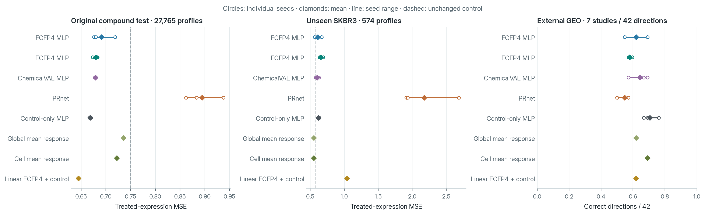
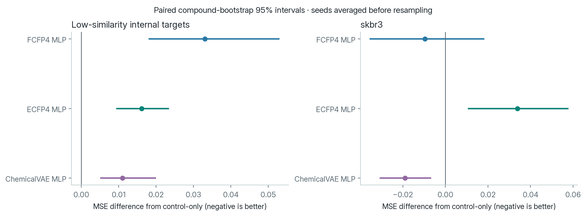
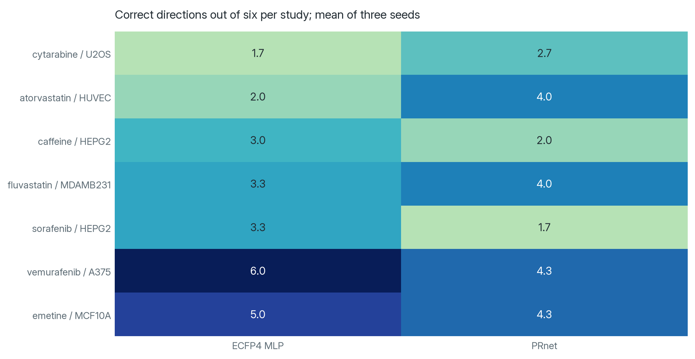

# Predicting gene-expression responses to chemical compounds

**Yernur Kenzhegazin · Alan Berdigaliyev · Hugo Telles**  
M2 GENIOMHE-AI · Supervisor: Amaury Giard, IBISC

This project compares three molecular representations in multilayer perceptrons (MLPs) with PRnet and simple baselines. The task is to predict treated expression for the 978 measured LINCS L1000 genes from a chemical structure and measured DMSO control expression.

[Read the full report](docs/REPORT.md) · [Report PDF](Research_Report.pdf) · [Analysis notebook](Analysis.ipynb) · [Poster](presentation/Conference_Poster.pdf) · [Detailed methods](METHODS.md)

**Main finding:** The chemical MLPs have lower expression-prediction error than PRnet under the shared protocol, but simple baselines remain stronger on the main evaluation sets. The small external panel does not establish a clear advantage for the chemical MLPs.

## Research question

A predictor of cellular responses could help prioritize chemical compounds before experimental testing. However, a low expression-prediction error may largely reflect the untreated cellular state rather than an accurate prediction of the chemical response.

Following [Amaury Giard's project brief](docs/Project_brief.pdf), this benchmark asks:

- Does performance generalize to unseen chemical compounds and an unseen cell line?
- Can the models predict the direction of regulation for six genes in external experiments?
- How sensitive are predictions to noise in the control measurements?

The central comparison is whether chemical information improves prediction beyond the control state. The experiment therefore includes models with different chemical encodings, a network without chemical inputs and simple statistical baselines.

## Data and evaluation sets

The study uses normalized LINCS Level 3 expression at **10 µM and 24 hours**, restricted to the **978 directly measured landmark genes**. Treated profiles are paired with measured DMSO controls matched by detection plate, cell line, exposure time and bead batch. The supplied compound assignments are preserved for eligible samples.

| Evaluation component | Size | What it tests |
|---|---|---|
| Training | 210,438 profiles; 8,168 compounds | Model fitting |
| Validation | 25,190 profiles; 1,029 compounds | Settings and checkpoint selection |
| Original internal test | 27,765 profiles; 1,019 compounds | Held-out compound identifiers |
| Low-similarity internal subset | 16,531 profiles; 474 compounds | Chemically more distant compounds |
| SKBR3 test | 574 profiles; 137 compounds | Transfer to an excluded cell line |
| External GEO panel | Seven studies; 42 gene directions | Regulation in independent experimental sources |

Training excludes SKBR3 and compounds above 0.7 ECFP4 Tanimoto similarity to the external screening compounds. The eligible expanded external panel also passes this threshold. The original internal test contains close training analogues, so the main chemical-generalization results use its separate subset with maximum training similarity at most 0.7.

The external panel reconstructs measurements for **AKT1, AURKB, EGFR, PIK3CA, SMAD3 and TP53** from dose-matched GEO studies identified through PharmGEO. These are seven study clusters, with six correlated gene observations per study.

## Pipeline


Each molecular representation enters a separate MLP. All models use the same eligible samples and measured controls. The predicted response is evaluated against treated expression, treatment-minus-control changes and external regulation directions.

## Models and experimental design

| Model | Chemical representation | Prediction |
|---|---|---|
| FCFP4 MLP | 1,024 feature-Morgan bits, radius 2 | Measured control plus a learned response |
| ECFP4 MLP | 1,024 atom-Morgan bits, radius 2 | Measured control plus a learned response |
| ChemicalVAE MLP | 196 frozen encoder values | Measured control plus a learned response |
| PRnet | Dose-scaled FCFP4 | Published generative network architecture |
| Control-only MLP | No chemical input | Response learned from control expression |

The residual MLPs use hidden layers of 512 and 256 units and predict both a mean response and positive variance. Control expression supplies cellular context; these models do not use cell-ID embeddings. PRnet predictions average 32 fixed decoder-noise draws.

Five main networks are trained with **three seeds** and the same small grid of AdamW settings. Validation Gaussian negative log likelihood (NLL) selects settings and checkpoints. Controls are standardized using training inputs only. Additional baselines predict unchanged control expression, the global or cell-specific training mean response, or a linear response from ECFP4 and controls.

The analysis also tests chemical-input shuffling, residual prediction versus initialization, separate control-group holdouts, synthetic control noise, measured-control subsampling and predictive interval coverage. These checks examine how a model achieves its score and where performance fails.

## Results



*Network points represent three training seeds; diamonds show their means. MSE measures expression error, while the external panel scores regulation direction.*

| Model | Low-similarity MSE | SKBR3 MSE | External correct / 42 |
|---|---:|---:|---:|
| FCFP4 MLP | 0.6892 | 0.6102 | 26.0 |
| ECFP4 MLP | 0.6723 | 0.6537 | 24.3 |
| ChemicalVAE MLP | 0.6671 | 0.6009 | 27.0 |
| PRnet | 0.9055 | 2.1759 | 23.0 |
| Control-only MLP | 0.6561 | 0.6198 | 29.7 |
| Global mean response | 0.7215 | 0.5505 | 26.0 |
| Cell mean response | 0.7080 | 0.5505 | 29.0 |
| Linear ECFP4 + control | 0.6350 | 1.0404 | 26.0 |

Network scores average three training seeds; fractional external counts are averages of integer counts from the individual runs. Lower MSE and higher correct-direction counts are better. Seed variability and paired uncertainty intervals are provided in the report and notebook.

### Simple baselines remain competitive

All three molecular MLPs have lower MSE than PRnet under this protocol. Nevertheless, the linear model performs best on the low-similarity internal subset, and the training mean-response baseline performs best on SKBR3. Good internal reconstruction therefore does not guarantee transfer to an unseen cell line.



*MSE differences from control-only, with descriptive 95% paired compound-bootstrap intervals. Negative values favor the chemical MLP. Per-run losses are averaged before resampling compounds.*

All three chemical MLPs have higher loss than control-only on the low-similarity subset. ChemicalVAE improves over control-only on SKBR3, but remains worse than the mean-response baseline. Chemical shuffling increases error, indicating input dependence; this does not establish a consistent benefit over a separately fitted baseline.

### External regulation varies across studies



*Correct directions out of six genes per study, averaged across three training seeds. Studies, rather than individual genes, are the resampling unit for external uncertainty intervals.*

The control-only network has the highest mean count among the five networks. Chemical-MLP versus PRnet accuracy intervals all span zero. Only 15 of the 42 measured directions satisfy the descriptive clear-change rule, so this panel provides limited evidence for ranking models.

## Interpretation and limitations

The results support a cautious assessment of prediction reliability: chemical features affect the networks, but their inclusion does not consistently improve accuracy or external regulation prediction. These are exploratory analyses of previously examined evaluation sets. The original internal test includes close analogues and shared control groups; stricter subsets address specific aspects of separation without establishing scaffold generalization. SKBR3 is one unseen cell line, the external panel is small, and LINCS/GEO platform differences remain. PRnet uses its published architecture with project-specific fitting; its original published numerical results are not exactly reproduced. The benchmark does not establish prospective drug-ranking utility.

## Reproduce the analysis

The report, figures and executed notebook can be read directly on GitHub. To rerun the analysis of the saved result tables, use Python 3.13:

```sh
git clone https://github.com/comp-bio-sys/Transversal_Project.git
cd Transversal_Project
python -m pip install -r requirements.txt
python run.py notebook
python run.py figures
```

The notebook contains executed outputs. Install JupyterLab with `python -m pip install jupyterlab` if needed, then open the notebook with `jupyter lab Analysis.ipynb`. The prediction example is skipped when data and weights are absent. For full verification and prediction, first restore the assets described in [DATA.md](docs/DATA.md), then run `python run.py check`. Recomputing the full evaluation with `python run.py evaluate` can take hours. Full training with `python run.py train --fresh` can take days and first backs up the existing experiment outputs. All commands are listed by `python run.py --help`.

A GitHub clone contains code, result tables and presentation files. The full submission ZIP also includes the arrays and weights needed for prediction and evaluation. See [Data and model files](docs/DATA.md) and [GitHub upload instructions](docs/GITHUB.md).

## Project files and sources

| Path | Contents |
|---|---|
| `Analysis.ipynb` | Executed analysis and prediction example |
| `MLP_PRnet_controls/` | Data preparation, encoding and PRnet network |
| `extension/` | Training, evaluation and robustness analysis |
| `extension/balanced/` | Results, settings and checkpoint metadata |
| `dose_matched/` | External studies and reconstructed measurements |
| `presentation/` | Figures, report builders and poster |
| `docs/` | Project brief, data instructions and GitHub guide |

Data and model references are listed in [SOURCES.md](MLP_PRnet_controls/SOURCES.md). The report discusses PRnet, chemCPA, PertDiT and the motivating benchmarking literature. Third-party licenses and published-figure attribution are retained with the corresponding files.
