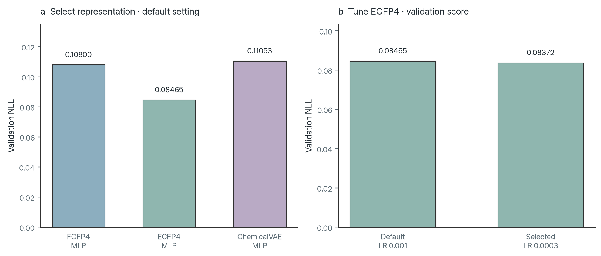
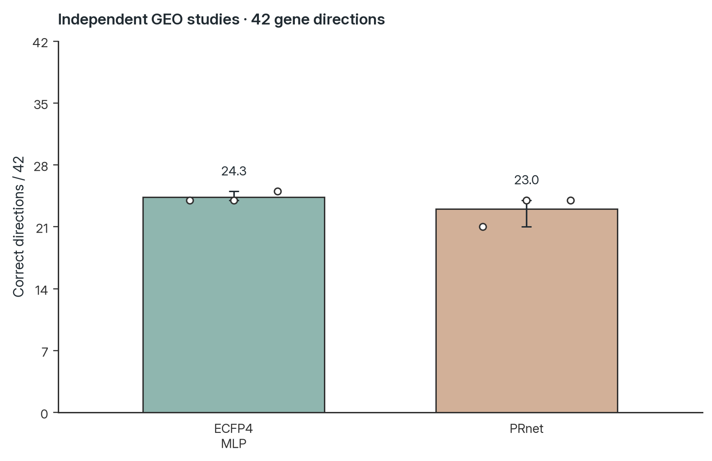
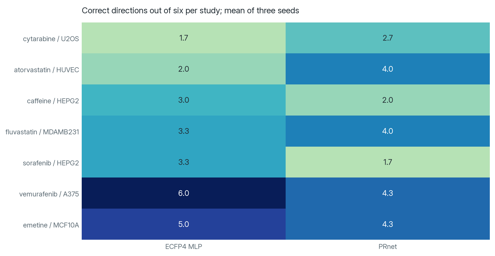

# Chemical perturbation response prediction

[Project overview](../README.md) · [PDF report](../Research_Report.pdf) · [Notebook](../Analysis.ipynb)

## Predicting responses to chemical compounds

M2 GENIOMHE-AI | Project report | 26 November 2026

Yernur Kenzhegazin · Alan Berdigaliyev · Hugo Telles  
Supervisor: Amaury Giard, IBISC

The project asks whether an MLP can predict chemical changes in gene expression and compare favorably with retrained PRnet. We compare FCFP4, ECFP4 and ChemicalVAE inputs, identify the validation-preferred MLP, examine its learning-rate refinement, and evaluate that predictor against PRnet. Both models receive measured DMSO expression and predict treated expression for 978 LINCS L1000 genes.

### Choose the representation using validation

| MLP candidate | Default validation NLL, seed 42 |
| --- | --- |
| FCFP4 MLP | 0.10800 |
| ECFP4 MLP | 0.08465 |
| ChemicalVAE MLP | 0.11053 |

ECFP4 has the lowest recorded default validation NLL. The representations were tuned in parallel; ECFP4 is identified here from the recorded validation scores. Test scores do not determine the designation.

### Compare refined ECFP4 with retrained PRnet

| Model or reference | Low-similarity MSE | SKBR3 MSE |
| --- | --- | --- |
| ECFP4 MLP | 0.6723 ± 0.0042 | 0.6537 ± 0.0299 |
| PRnet | 0.9055 ± 0.0404 | 2.1759 ± 0.4413 |
| Unchanged DMSO expression | 0.7357 | 0.5689 |

Network values are means ± sample standard deviations across three training seeds. Lower MSE is better. Unchanged DMSO directly predicts the matched 978-gene control mean; it has no fitted weights or training-seed variation. The low-similarity test has 474 compounds / 16,531 profiles, and SKBR3 has 137 compounds / 574 profiles.

Refined ECFP4 has lower MSE than PRnet in both tests and improves on unchanged DMSO for distant compounds. On SKBR3, unchanged DMSO is stronger. Lowering ECFP4's learning rate improves validation NLL but worsens SKBR3 and external scores relative to its default setting. External evidence does not establish a clear advantage over PRnet. The experiments therefore support a qualified comparison, not a validated drug-ranking method.

The tests were examined during development, so results are exploratory. Other representation scores and stronger simple baselines remain in the supplement and saved tables.

## What the data represent

One expression profile is one bulk experimental sample with 978 gene values. Matrix rows are samples; columns are directly measured landmark genes. Values are supplied normalized LINCS Level 3 expression, not RNA-sequencing read counts, percentages or probabilities. Replicates and different cell lines may share a compound, so the number of profiles is not the number of independent compounds.

| Stage | Retained data |
| --- | --- |
| Supplied usage manifest | 298,470 selected treatment profiles |
| Matched DMSO cohort | 269,364 profiles; 47,995 DMSO measurements in 2,903 groups |
| Screened training | 210,438 profiles; 8,168 compounds; 148 cell lines |
| Validation | 25,190 profiles; 1,029 compounds |
| Original internal test | 27,765 profiles; 1,019 compounds |
| Low-similarity test subset | 16,531 profiles; 474 compounds; maximum training Tanimoto ≤0.7 |
| SKBR3 test | 574 profiles; 137 compounds; 226 measured DMSO controls |
| External GEO panel | Seven studies, six genes per study; 42 observed directions |

### How DMSO expression is constructed

For each treatment, quality-passed vehicle controls are matched by detection plate, cell line, exposure time and bead batch. Replicates are averaged separately for each gene, producing a 978-value DMSO expression vector. This vector supplies the cellular context and also defines the unchanged-expression reference. The main cohort is restricted to 10 µM and 24 hours.

Treatment targets retain their supplied Level 3 scale, with no additional logarithm or target standardization. DMSO inputs are standardized gene by gene using training data only. The MLP response is added back to the original DMSO values. FCFP4 and ECFP4 descriptors are binary molecular features; ChemicalVAE descriptors are continuous molecular features. They are not expression measurements.

Original compound assignments are preserved for retained profiles. SKBR3, the separately named SKB line and close analogues of the external screening compounds are excluded from fitting. The original internal test still contains 545 compounds above 0.7 similarity to training and 27,752 profiles sharing a control group with training. The low-similarity subset addresses chemical proximity; it does not establish scaffold or full experimental independence.

## From the input files to a prediction


Figure 1. The project procedure. Treatment samples are paired with matching DMSO replicates; their per-gene mean supplies the model input and unchanged-expression reference. Fixed compound assignments are screened; three encodings are compared by validation NLL. The preferred ECFP4 MLP is examined before and after refinement and compared with retrained PRnet. This sequence summarizes completed parallel tuning runs. Evaluation uses held-out measurements. Dish drawings, molecular examples and expression strips are schematic; sample counts come from the saved audit.

| Input | How it is used |
| --- | --- |
| l1000_level3_filtered_train_clean.feather | Provides treatment targets and sample metadata |
| compound_split.csv | Assigns compounds to training, validation or test |
| sample_usage.feather | Identifies the selected sample IDs within each split |
| Measured LINCS DMSO profiles | Supply the matched per-gene replicate mean |
| zinc.json and zinc_encoder.h5 | Define the frozen ChemicalVAE encoder |
| External GEO contrasts | Provide independent measured regulation directions |

Each molecular representation enters its own MLP; the three descriptors are not concatenated into one model. Training targets are measured treated profiles. At evaluation, a new structure and an appropriate DMSO profile produce a 978-gene prediction. GEO measurements are used for scoring only: external predictions use cell-line mean LINCS DMSO expression as the reference input.

```sh
chemical features + standardized DMSO expression
  -> 512 hidden units -> 256 hidden units
  -> predicted change and positive variance
predicted treated expression = DMSO expression + predicted change
```

## Select ECFP4 and assess its refinement



Figure 2. Left: best seed-42 validation Gaussian NLL for the three MLPs at the shared default setting. Right: ECFP4 at the default and lower-learning-rate settings. Lower is better. These are single-seed checkpoint-selection values without uncertainty bars, not test scores. NLL assesses the predicted mean and variance; the preferred model is specific to this criterion.

| ECFP4 setting | Validation NLL | SKBR3 MSE | GEO correct / 42 |
| --- | --- | --- | --- |
| Default | 0.08465 | 0.5803 | 26.3 |
| Lower learning rate | 0.08372 | 0.6537 | 24.3 |

Validation NLL is from seed 42; the two evaluation columns average seeds 42, 43 and 44. Reducing learning rate from 0.001 to 0.0003, at weight decay 0.01, improves validation NLL but worsens both listed evaluations. The main comparison retains the validation-selected setting instead of choosing retrospectively from test scores. ECFP4 is validation-preferred, not a universal test winner.

FCFP4 and ECFP4 have 1,024 radius-2 Morgan bits using functional-class and atom invariants respectively; ChemicalVAE supplies 196 frozen values. Each MLP concatenates its representation with standardized DMSO expression, uses 512 and 256 hidden units with ReLU and 0.1 dropout after the first layer, and predicts a response plus positive variance. The zero-initialized response is added to raw DMSO expression. There is no cell-ID embedding.

All models used AdamW, batch size 512 and patience seven epochs. Three learning-rate/weight-decay settings were evaluated in parallel for each representation; seed-42 validation NLL selected each setting. Every run uses its lowest-validation-NLL checkpoint. The Gaussian constant is omitted. Trials still improving at the initial 50-epoch cap were refitted with a 150-epoch cap before final validation selection. Full settings and curves are retained.

PRnet uses its published classes, dose-scaled FCFP4 and project-specific standardized DMSO inputs. Validation uses one fixed decoder draw; test means average 32 fixed draws. Its selected learning rate / decay is 0.0003 / 0.01. This retrains the architecture on our cohort; it does not reproduce the paper's original numerical results. The separate source-recipe run is supplementary.

## Expression prediction depends on the test setting


Figure 3. Treated-expression MSE for the refined ECFP4 MLP, retrained PRnet and unchanged DMSO expression on (a) the low-similarity compound subset and (b) excluded SKBR3. Bars show mean network scores over three training seeds; dots mark individual runs and whiskers span the smallest to largest seed score. These whiskers are seed ranges, not standard deviations or confidence intervals. DMSO expression is a measured reference without training variation. Lower values are better; both panels use the supplied Level 3 target scale.

MSE is the squared difference between predicted and measured treated expression, averaged across the 978 genes and all eligible profiles. It measures reconstruction error in squared expression units. It does not directly measure a drug's usefulness, mechanism or biological effect strength.

Refined ECFP4 has MSE 0.6723 on the low-similarity subset, compared with 0.9055 for PRnet and 0.7357 for unchanged DMSO. On SKBR3, ECFP4 (0.6537) again improves on PRnet (2.1759), but unchanged DMSO (0.5689) is stronger than either model. Improvement over PRnet does not establish general transfer.

The compound subset is selected by maximum training ECFP4 Tanimoto similarity ≤0.7, using structures rather than observed model errors. It still includes shared control groups and is not scaffold-disjoint. SKBR3 tests an excluded cell line; 86 of its compounds were seen in other training cell lines and 51 were absent from training. It is not a uniformly joint unseen-compound/unseen-cell test.

Response Pearson correlation, retained in the result tables, subtracts DMSO expression from both predictions and targets before comparing the 978-gene patterns. This complementary metric distinguishes expression reconstruction from recovery of the treatment response.

## External regulation: a small independent measurement panel



Figure 4. Correct regulation directions for the refined ECFP4 MLP and retrained PRnet among 42 gene-study observations in seven eligible GEO studies. Bars show the mean correct count across three training seeds, dots show individual runs and whiskers span their minimum and maximum. These are seed ranges, not confidence intervals over external studies. A correct direction means agreement between predicted and measured treatment-minus-reference signs. Unchanged DMSO expression predicts zero response and has no up/down classification score; it is not assigned an artificial zero-percent accuracy.

| Model | Correct directions, seeds 42 / 43 / 44 | Mean / 42 |
| --- | --- | --- |
| ECFP4 MLP | 24 / 24 / 25 | 24.3 |
| PRnet | 21 / 24 / 24 | 23.0 |

The six genes are AKT1, AURKB, EGFR, PIK3CA, SMAD3 and TP53. The panel contains seven eligible GEO studies at 10 µM and 24 hours, spanning six cell lines. Norepinephrine/A549 is excluded because it has a training analogue with similarity 1.0. The panel was curated for available contrasts rather than sampled exhaustively from PharmGEO.

Observed signs come from GEO treatment-versus-control measurements. Predicted signs come from model-treated expression minus cell-mean LINCS DMSO expression. Dose and time are matched, but platform, cell culture and laboratory effects remain. GEO values are not substituted into the model as input, and expression magnitudes across these platforms are not treated as directly interchangeable.

ECFP4 averages 24.3 correct directions out of 42, compared with 23.0 for PRnet. The paired difference is 3.2 percentage points, with a descriptive study-bootstrap interval from -13.5 to +19.0 points. It therefore does not resolve a reliable external advantage. The seven studies, rather than the 42 correlated gene labels or repeated training seeds, determine the amount of independent external evidence.

## What the external heatmap values mean



Figure 5. Correct directions out of six genes for each compound/cell-line study, averaged over three training seeds. Rows are external studies; columns are refined ECFP4 and PRnet. Scores range from 0 to 6, with darker shading indicating more correct predictions. Values are counts of correct signs, not expression values or effect sizes.

A value of 6.0 means all six directions were correct in every training run. A value such as 4.3 is a rounded average of integer counts from the three runs. Summing the unrounded study means yields the mean correct count out of 42. The six genes within a study are correlated, so uncertainty is estimated by resampling entire studies.

| Model | All measured labels | Clear-change subset |
| --- | --- | --- |
| ECFP4 MLP | 24.3 / 42 | 9.7 / 15 |
| PRnet | 23.0 / 42 | 8.3 / 15 |

Twenty-seven labels have completely separated treated and control replicate values. Fifteen also have an absolute mean log-expression change of at least 0.5. This is a descriptive sensitivity rule, not a differential-expression significance test. Counts above use the same predictions on two different label subsets; the smaller denominator must be considered.

RNA-seq counts are normalized by median-ratio size factors, then transformed as log2(count + 0.5). Microarrays use the per-sample median of uniquely mapped probes on a log2 scale; GSE2450 is log2-transformed after a lower bound of 1. Weak effects and few replicates make some directions uncertain. An unconvincing change is not proof of biological equivalence; a calibrated up/down/unchanged test remains missing.

## How sensitive are predictions to noisy DMSO inputs?


Figure 6. Total SKBR3 treated-expression MSE for refined ECFP4, PRnet and unchanged DMSO as Gaussian noise is added to DMSO inputs. Noise SD is 0, 0.25, 0.5 or 1 times each gene's measured within-plate DMSO replicate SD. Nonzero levels average 20 technical draws per training seed; bands span the seed means. DMSO has no training-seed band. At noise level zero, these are the clean SKBR3 scores in Figure 3. Lower is better.

DMSO profiles are measured controls, not noiseless expression values. Their replicates vary. The project's robustness question is addressed by adding a known amount of noise to these inputs while keeping the fitted models and measured treated targets fixed. The vertical axis shows total MSE, so clean and perturbed predictions are directly comparable.

| Model or reference | Clean SKBR3 MSE | MSE at added noise SD = 1 |
| --- | --- | --- |
| ECFP4 MLP | 0.6537 | 0.9928 |
| PRnet | 2.1759 | 2.2292 |
| Unchanged DMSO expression | 0.5689 | 0.8876 |

ECFP4 error rises more with added noise, but remains lower than PRnet's total error. PRnet's flatter curve describes smaller sensitivity around an already higher clean-input error. This agrees with the clean SKBR3 comparison; a smaller change is not the same as a smaller prediction error.

A shared noisy reference is used for profiles on the same plate. Noise is applied independently across genes. This does not capture biological covariance, all assay errors or uncertainty in the mean of a particular replicate count. Twenty technical draws are not twenty independent experiments.

A separate diagnostic recomputes DMSO means from half of the observed control replicates. Predictive-interval coverage and chemical-input shuffling are also retained in the supplementary analyses. These checks answer different questions from synthetic input-noise sensitivity.

## Coverage of the project objectives

| Objective in the brief | What was completed | Remaining limitation |
| --- | --- | --- |
| Review perturbation models and metrics | PRnet and MLP comparison; chemCPA, PertDiT and benchmarking literature discussed | Focused review, not an exhaustive method benchmark |
| Fit PRnet on the project dataset | Published architecture retrained on the common screened LINCS cohort | Project preprocessing and small tuning budget; not original-paper score reproduction |
| Compare representations and refine an MLP | Three default validation scores; ECFP4 learning-rate refinement; comparison with retrained PRnet | Designation from completed parallel runs; validation gain does not guarantee transfer |
| Test unseen compounds and SKBR3 | Compound-disjoint test, low-similarity subset and excluded cell line | No scaffold holdout; one unseen cell line; some shared control groups |
| Predict regulation of six genes | Seven dose/time-matched GEO studies; 42 directions and stronger-label sensitivity subset | Few studies; weak effects; no calibrated unchanged class |
| Measure sensitivity to noise | Gaussian DMSO noise and measured-replicate subsampling | Limited noise model; no full biological uncertainty model |
| Assess whether the approach is useful | Compare with unchanged DMSO and supplementary learned/statistical baselines | No prospective compound ranking or functional validation |

The completed experiments answer the available-data questions in the brief, but they do not make the predictors a validated drug-screening system. The clearest result is that ranking methods depends on the evaluation setting. The ability to use a chemical input is distinct from improving predictions with it.

### Next scientific step

Before further model changes, freeze a larger external set of dose/time-matched contrasts. Separate compounds, cell lineages and control groups where feasible. Predefine meaningful effect and unchanged-label criteria, retain simple comparators, and evaluate the selected model once. A proposed compound ranking then requires an independent functional assay.

Internal and external tests were reused during development. Three seeds describe fitting variation on the same data, not independent biological replication. The reported uncertainty intervals remain descriptive and do not remove this limitation.

## How to reproduce the analysis

| Code | Purpose |
| --- | --- |
| MLP_PRnet_controls/match_controls.py | Match DMSO measurements and retain supplied split assignments |
| prepare_features.py; encoder.py | Create fingerprints and frozen ChemicalVAE features |
| extension/benchmark.py | Define residual MLPs and construct PRnet |
| balanced_train.py; tune_models.py | Fit models and select settings/checkpoints with validation NLL |
| scientific_data.py; evaluate_balanced.py | Load the common cohort and calculate predictions and metrics |
| dose_matched/measure.py | Reconstruct external measurements from GEO files |
| diagnose_final.py; calibration.py | Evaluate chemical shuffling, input noise and predictive intervals |
| summarize_revision.py; verify_revision.py | Summarize paired comparisons and check result consistency |
| presentation/ | Reproduce scientific plots; view the finished poster |

```sh
python -m pip install -r requirements.txt
python run.py figures
python run.py notebook

# With the data and weights restored:
python run.py check
python run.py evaluate
python run.py train --fresh
```

The README explains how to run the analysis. Analysis.ipynb walks through the saved results. Data and model files needed for training are listed in docs/DATA.md.

## Supplementary checks and negative evidence

The main test figures compare the validation-preferred ECFP4 MLP, PRnet and measured DMSO expression. FCFP4 and ChemicalVAE test results are retained here rather than used to choose the lead MLP. Additional experiments remain part of the project because they test whether chemistry contributes useful information. The control-only MLP is a separately fitted network without chemical inputs; it is different from unchanged DMSO expression.

| Supplementary comparator | Low-similarity MSE | SKBR3 MSE | GEO correct / 42 |
| --- | --- | --- | --- |
| FCFP4 MLP | 0.6892 | 0.6102 | 26.0 |
| ChemicalVAE MLP | 0.6671 | 0.6009 | 27.0 |
| Control-only MLP | 0.6561 | 0.6198 | 29.7 |
| Global mean response | 0.7215 | 0.5505 | 26.0 |
| Cell mean response | 0.7080 | 0.5505 | 29.0 |
| Linear ECFP4 + DMSO | 0.6350 | 1.0404 | 26.0 |

ChemicalVAE has the lowest test MSE among the MLPs, but did not have the lowest validation NLL. The control-only network has lower low-similarity MSE than all three chemical MLPs and a higher mean external count. Linear ECFP4 + DMSO is strongest on the low-similarity subset; training mean-response baselines are strongest on SKBR3. These findings limit claims that chemical features add consistent predictive value, even though the chemical MLPs improve on PRnet.

| Additional analysis | Interpretation |
| --- | --- |
| Chemical-input shuffling | A shuffling penalty demonstrates input dependence, not a causal mechanism or superiority to a fitted context-only model |
| Residual × initialization ablation | Separates a residual connection from zero-initialized mean-head effects under shared fixed settings |
| Joint compound/control-group holdout | Reduces shared experimental context; the smaller fitting cohort is an additional change |
| Paired compound and study intervals | Descriptive uncertainty with clustered observations; not confirmatory evidence on reused tests |
| Coverage and replicate subsampling | Check predicted intervals and sensitivity to the available measured controls |
| Source-recipe PRnet run | Different preprocessing; one seed; 24/42 dose-matched directions; raw MSE is on a different scale |

Details, figures and source tables are indexed in [docs/SUPPLEMENTARY_ANALYSES.md](docs/SUPPLEMENTARY_ANALYSES.md). Full score tables retain the original internal test, stricter subsets and all supplementary comparators. Their different cohorts and fitting settings should not be pooled into one ranking.

For external chemical-MLP versus PRnet comparisons, all study-bootstrap intervals include zero. Only 15 of 42 labels meet the stronger-change rule. A reliable three-way up/down/unchanged classifier, broad cell-line generalization and prospective compound-selection utility remain unproven.

## References

1. Giard, A. M2 Research Project (2026). Project brief, IBISC.

2. Subramanian et al. A Next Generation Connectivity Map: L1000 Platform and the First 1,000,000 Profiles. Cell 171, 1437–1452.e17 (2017). doi:10.1016/j.cell.2017.10.049.

3. Qi et al. Predicting transcriptional responses to novel chemical perturbations using deep generative model for drug discovery. Nature Communications 15, 9256 (2024). doi:10.1038/s41467-024-53457-1.

4. Hetzel et al. Predicting Cellular Responses to Novel Drug Perturbations at a Single-Cell Resolution. Advances in Neural Information Processing Systems 35 (2022). doi:10.52202/068431-1937.

5. Hu et al. Predicting drug-perturbed transcriptional responses using multi-conditional diffusion transformer. Quantitative Biology 14(1), e70016 (2026). doi:10.1002/qub2.70016.

6. PRnet source code. https://github.com/Perturbation-Response-Prediction/PRnet. Apache-2.0 license.

7. PharmGEO data release. Zenodo. doi:10.5281/zenodo.16556994.

8. NCBI Gene Expression Omnibus: GSE153871, GSE2450, GSE200700, GSE59008, GSE225537, GSE42872 and GSE113505.

9. Wei et al. Benchmarking algorithms for generalizable single-cell perturbation response prediction. Nature Methods 23, 451–464 (2026). doi:10.1038/s41592-025-02980-0.

10. Wu et al. PerturBench: Benchmarking Machine Learning Models for Cellular Perturbation Analysis. arXiv:2408.10609.
