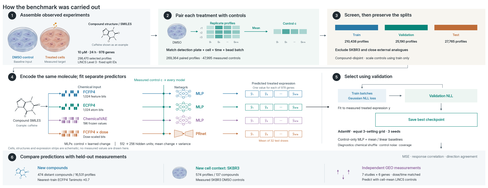
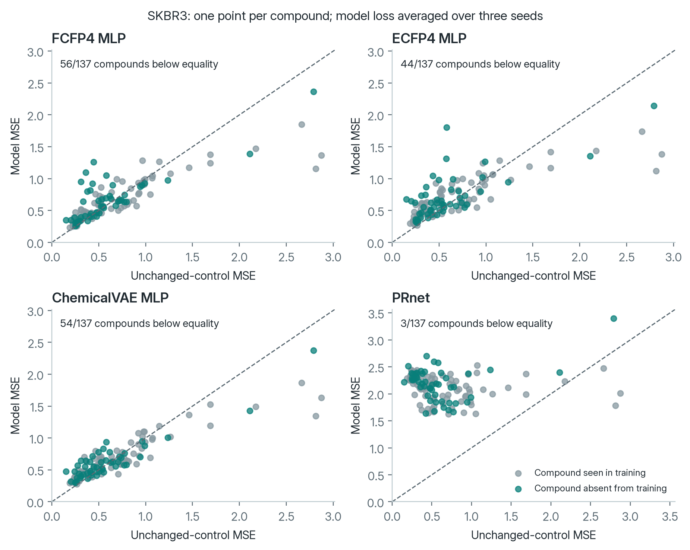
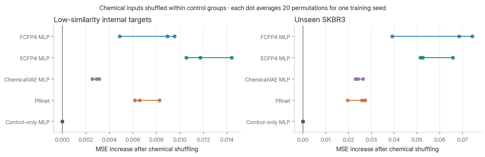
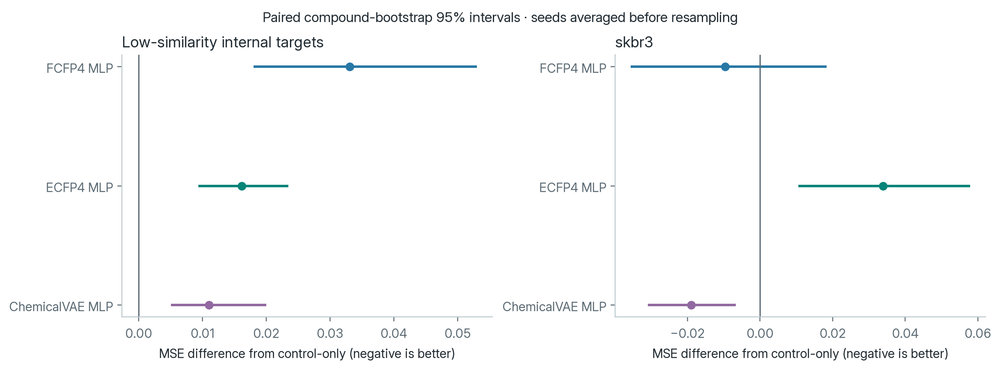
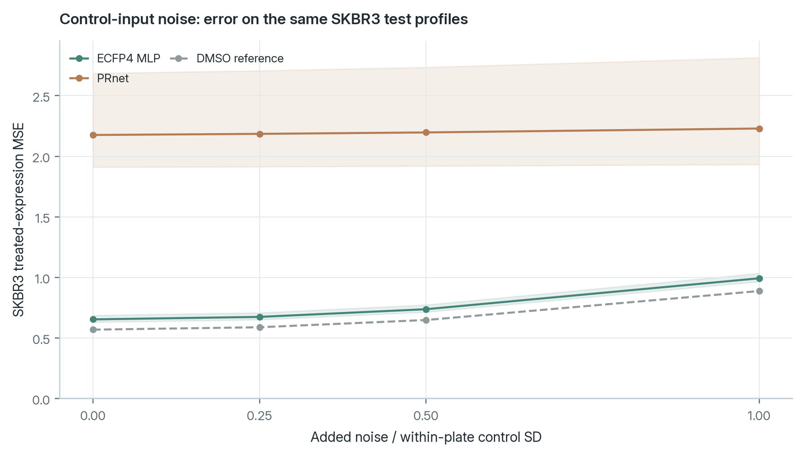
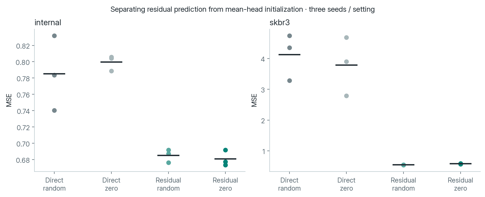
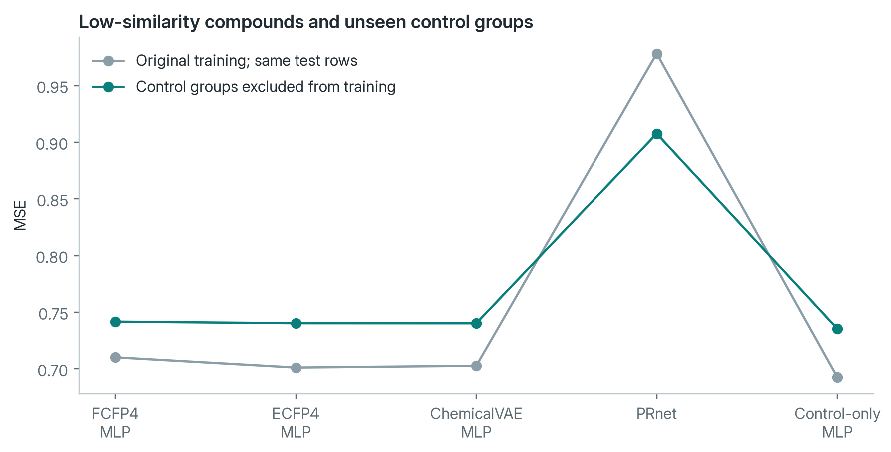
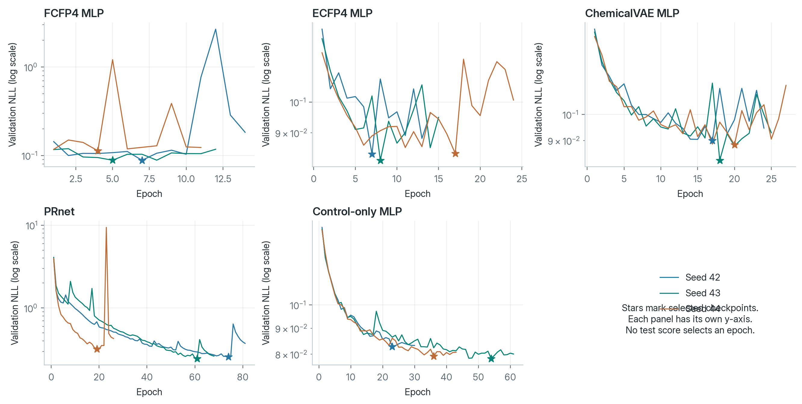

# Chemical perturbation response prediction

[Project overview](../README.md) · [PDF report](../Research_Report.pdf) · [Notebook](../Analysis.ipynb)

## What chemical information adds to expression prediction

M2 GENIOMHE-AI | Project report | 26 November 2026

Yernur Kenzhegazin · Alan Berdigaliyev · Hugo Telles  
Supervisor: Amaury Giard, IBISC

This project asks whether a model can predict the cellular response to a chemical compound accurately enough to help evaluate new compounds. We compare three molecular representations in multilayer perceptrons (MLPs) with PRnet and simple baselines. The main target is treated expression for 978 measured L1000 genes; the biological response is the difference from a measured vehicle control.

### Experimental design

All five main networks use three training seeds and the same small, validation-only tuning budget. Comparisons include a linear baseline and training-only mean-response baselines. Chemical-input shuffling, a factorial residual/initialization ablation, a joint compound/control-group holdout, input-noise tests and uncertainty diagnostics examine what drives model performance.

| Model | Low-similarity MSE | SKBR3 MSE |
| --- | --- | --- |
| FCFP4 MLP | 0.6892 ± 0.0307 | 0.6102 ± 0.0528 |
| ECFP4 MLP | 0.6723 ± 0.0042 | 0.6537 ± 0.0299 |
| ChemicalVAE MLP | 0.6671 ± 0.0008 | 0.6009 ± 0.0239 |
| PRnet | 0.9055 ± 0.0404 | 2.1759 ± 0.4413 |
| Control-only MLP | 0.6561 ± 0.0016 | 0.6198 ± 0.0106 |

The low-similarity test contains 16,531 profiles for 474 compounds with maximum training ECFP4 similarity at most 0.7. Values are means ± sample standard deviations across three independently initialized training runs. This is training variability, not a confidence interval over new biological experiments. Detailed baselines, direction results and paired intervals follow.

The main finding is the strength of simple alternatives. On the low-similarity test, the best chemical MLP (ChemicalVAE MLP) has MSE 0.6671, compared with 0.6561 for control-only and 0.6350 for ridge. On SKBR3, the best chemical MLP has MSE 0.6009, compared with 0.5505 for the training mean response. Beating PRnet in this shared protocol therefore does not establish added predictive value from chemistry.

### Scope of the conclusion

This benchmark is exploratory: the external panel and internal tests were examined during model development. Repeated training measures variability on the available data, but does not provide independent confirmation. The results describe prediction, chemical-input dependence and transfer within the tested settings; they do not validate a stand-alone drug-discovery ranking system.

## Why compare simple and generative models?

The brief asks whether perturbation predictors are reliable enough to evaluate new compounds. Model complexity alone cannot answer that question. The comparison needs a common cohort, explicit generalization tests and baselines that reveal how much can be predicted from cellular context without chemical information.

| Approach | Published idea | Implementation |
| --- | --- | --- |
| PRnet | A generative network conditions transcriptional predictions on chemical perturbations and cellular state. | Published network classes are fitted on the project cohort; source-recipe sensitivity is kept separate. |
| chemCPA | An encoder-decoder learns responses to unseen drugs and can transfer information from bulk screening data. | Literature context for molecular encoders and transfer; chemCPA itself is not trained here. |
| PertDiT | A diffusion transformer combines control transcriptomes with text-based chemical and dose representations. | Literature context for richer conditional generation; PertDiT itself is not trained here. |
| Residual MLP and simple baselines | Predict a response around the measured control, with or without chemical features. | Test whether extra chemical representation and nonlinear capacity add useful information. |

Primary sources: [Qi et al., PRnet (2024)](https://www.nature.com/articles/s41467-024-53457-1); [Hetzel et al., chemCPA (NeurIPS 2022)](https://papers.neurips.cc/paper_files/paper/2022/hash/aa933b5abc1be30baece1d230ec575a7-Abstract-Conference.html); [Hu et al., PertDiT](https://onlinelibrary.wiley.com/doi/full/10.1002/qub2.70016). The supplied Wei et al. benchmark motivates checking simple alternatives and complementary metrics. Its single-cell rankings are not transferred to our bulk-L1000 experiment.

### Why use several metrics?

Treated-expression MSE measures reconstruction error, but a model can lower it by exploiting a stable cell state. Treatment-minus-control correlation asks whether the response pattern is recovered. Direction accuracy addresses the six external genes directly. Validation NLL evaluates a probabilistic prediction and selects checkpoints; empirical coverage checks whether its uncertainty matches observed outcomes. Chemical shuffling and a control-only model ask different questions: whether chemistry affects predictions, and whether adding it improves prediction.

This is a focused methodological review, not a claim to benchmark every published method. The chosen experiments prioritize the models and data restrictions specified in the project brief.

## The pipeline, from input files to scientific tests



Figure 1. Data assembly, control pairing, screening, encoding, validation-based selection and held-out evaluation. The blue dish represents the control input; the orange dish represents the measured treated target. Caffeine illustrates the molecular input. Control replicates are averaged per gene; output tiles denote predicted expression values. Dishes and colors are schematic; counts come from the audit.

### What enters the model

The input files define the common experiment: l1000_level3_filtered_train_clean.feather supplies treated-expression targets, compound_split.csv supplies compound assignments and sample_usage.feather supplies selected sample IDs. After control pairing and screening, retained rows keep their original split labels. Training inputs alone determine control scaling; validation NLL selects settings and checkpoints. Test sets are evaluated after fitting.

FCFP4 and ECFP4 supply 1,024 binary molecular features; the frozen ChemicalVAE encoder supplies 196 continuous values. Each residual MLP adds a learned 978-gene response to measured control expression. For external GEO scoring, predictions use a cell-specific mean of LINCS control groups. GEO treated-minus-control measurements provide the observed directions, not model inputs. This cross-platform comparison is separate from the plate-matched LINCS tests.

```sh
chemical features + standardized control
    -> 512 hidden units -> 256 hidden units
    -> predicted change and positive variance
predicted treated expression = control + predicted change
```

## Data preparation and what the splits actually test

One profile is one measured sample, represented by 978 gene-expression values. Rows of the expression matrix are profiles; columns are landmark genes. A compound can occur in several profiles, cell lines and experimental replicates, so a profile count is not a count of independent compounds. The values are supplied LINCS Level 3 expression measurements, not RNA-sequencing read counts, percentages or probabilities.

| Stage | Retained profiles / details |
| --- | --- |
| Shared usage manifest | 298,470 selected profiles |
| Matched measured controls | 269,364 profiles; 47,995 DMSO measurements in 2,903 groups |
| Screened training | 210,438 profiles; 8,168 compounds; 148 cell lines |
| Screened validation | 25,190 profiles; 1,029 compounds |
| Screened internal test | 27,765 profiles; 1,019 compounds |
| SKBR3 test | 574 profiles; 137 compounds; 226 measured DMSO controls |
| External GEO panel | Seven eligible studies; six genes per study; 42 directions |

Matched controls are quality-passed DMSO profiles from the same detection plate, cell line, 24-hour exposure and bead batch. Their mean is the 978-value control vector. Targets retain the supplied Level 3 scale: the preparation code applies no additional logarithm or target standardization. Control inputs are standardized gene by gene using training-only means and standard deviations. The residual prediction is then added to the original control values. Inferred genes are excluded.

The original compound assignments are preserved for retained samples. Molecules above 0.7 ECFP4 Tanimoto similarity to the original external screening panel are excluded, as are SKBR3 and the separately named SKB line. The expanded seven-study panel was checked directly: all seven structures also remain at or below 0.7 similarity to the retained training molecules.

### Compound separation is not full experimental separation

The internal audit found 545 of 1,019 test compounds above 0.7 similarity to a training compound. It also found 27,752 of 27,765 test profiles with a matched control group also used by training profiles. Shared measured controls do not automatically leak a treated target, but they restrict the independence of this test. We therefore add a separate joint holdout and provide similarity-stratified results. Of the 1,019 test compounds, 295 have an identical ECFP4 vector to a training molecule; 293 share connectivity when stereochemistry is ignored. ECFP4 in this project does not encode chirality. The 474-compound low-similarity subset is therefore reported separately. No scaffold-disjoint claim is made.

SKBR3 tests an unseen cell line; 86 compounds were seen in training in other cells and 51 were absent from training. Six of 580 retrieved treatment profiles have undisclosed structures and are excluded equally for all representations. Dose and time are 10 µM and 24 hours. These are different generalization questions from completely new compounds in completely new cell lines.

## Models, fitting and the fair-comparison limits

| Model | Chemical input | Core prediction rule |
| --- | --- | --- |
| FCFP4 MLP | 1,024-bit radius-2 feature Morgan | Control + learned response |
| ECFP4 MLP | 1,024-bit radius-2 atom Morgan | Control + learned response |
| ChemicalVAE MLP | 196 frozen encoder values | Control + learned response |
| Control-only MLP | None | Control + learned response |
| PRnet | FCFP4 scaled by log10(1 + 10 µM) | Published PGM architecture with Gaussian decoder noise |

The MLP trunk is 512 → 256 units with ReLU and 0.1 dropout after the first hidden layer. A mean head predicts a 978-gene response and a softplus variance head returns a positive variance. The main residual mean heads start at zero, so initial predictions equal the control. FCFP4 and ECFP4 have equal input width; ChemicalVAE has fewer input parameters. The supplied encoder is frozen and is not fitted to expression targets in this project. Its original pretraining exposure is not independently audited; unseen compounds here are absent from response-model training, not necessarily from unsupervised encoder pretraining.

Every main model uses seeds 42, 43 and 44, batch size 512, patience of seven epochs and an initial 50-epoch cap. Any trial still improving at that cap is refitted from the same seed with a 150-epoch limit before final validation selection; already-stopped trials are unchanged. We compare three AdamW settings: learning rate 0.001 / decay 0.01; learning rate 0.0003 / decay 0.01; and learning rate 0.001 / decay 0.0001. Seed 42 validation Gaussian NLL selects the setting; the chosen setting is then evaluated with all three seeds. Test scores do not select the setting or checkpoint. The Gaussian constant is omitted from NLL.

| Model | Validation-selected setting | Parameters |
| --- | --- | --- |
| FCFP4 MLP | lower_decay | 1,659,556 |
| ECFP4 MLP | lower_lr | 1,659,556 |
| ChemicalVAE MLP | lower_lr | 1,235,620 |
| PRnet | lower_lr | 551,204 |
| Control-only MLP | lower_lr | 1,135,268 |

PRnet uses its published network classes with project-specific standardization, fitting and data pairing. Validation uses one fixed decoder-noise draw; final prediction averages 32 fixed draws. This is a shared-budget comparison on this cohort, not a reproduction of the article’s published numerical scores or proof that PRnet is optimally tuned. A separate source-recipe run in extension/reference trained for 110 epochs and selected epoch 88 at seed 42. Its dose-matched evaluation averages 32 fixed decoder draws and scores 24/42 directions. It uses different expression preprocessing; this one-seed sensitivity result is not pooled with the main comparison, and its raw MSE is on a different scale. The separate 24/38 score in its original summary uses the original external labels and one decoder draw, so it is not directly comparable to the dose-matched score.

## Performance across evaluation settings

MSE is the mean squared difference between predicted and measured treated expression, averaged over profiles and genes. Lower is better; zero would mean exact prediction. Its units are squared Level 3 expression units. Values after ± show variation across the three training seeds. External counts instead measure how many of 42 gene directions were predicted correctly.

| Model | Internal MSE | SKBR3 MSE | GEO correct, seeds 42 / 43 / 44 |
| --- | --- | --- | --- |
| FCFP4 MLP | 0.6913 ± 0.0237 | 0.6102 ± 0.0528 | 23 / 29 / 26 of 42 |
| ECFP4 MLP | 0.6796 ± 0.0053 | 0.6537 ± 0.0299 | 24 / 24 / 25 of 42 |
| ChemicalVAE MLP | 0.6789 ± 0.0011 | 0.6009 ± 0.0239 | 28 / 29 / 24 of 42 |
| PRnet | 0.8944 ± 0.0392 | 2.1759 ± 0.4413 | 21 / 24 / 24 of 42 |
| Control-only MLP | 0.6682 ± 0.0016 | 0.6198 ± 0.0106 | 32 / 29 / 28 of 42 |
| Global mean response | 0.7357 | 0.5505 | 26 of 42 |
| Cell mean response | 0.7224 | 0.5505 | 29 of 42 |
| Linear ECFP4 + control | 0.6445 | 1.0404 | 26 of 42 |

The unchanged-control baseline has internal MSE 0.7495 and SKBR3 MSE 0.5689. Its predicted response is exactly zero, so it abstains on direction; an apparent 0% direction score would not be a meaningful up/down classifier comparison.

The linear baseline uses ECFP4 and standardized controls to fit the treated-minus-control response. Its ridge penalty is selected by validation MSE from four candidates. Global and cell-specific mean responses use training targets only. The cell-specific baseline falls back to the global response for unseen SKBR3. Different selection objectives for ridge and the probabilistic networks are stated explicitly.

The linear model achieves internal MSE 0.6445, but its SKBR3 MSE is 1.0404. This illustrates why internal reconstruction accuracy alone cannot establish cell-line transfer. Representation rankings must be read separately for the internal test, SKBR3 and external direction.

### Response metrics and repeatable signal

| Model | Internal response r | SKBR3 response r | SKBR3 direction |
| --- | --- | --- | --- |
| FCFP4 MLP | 0.206 | 0.168 | 63.8% |
| ECFP4 MLP | 0.217 | 0.165 | 63.9% |
| ChemicalVAE MLP | 0.221 | 0.147 | 62.7% |
| PRnet | 0.192 | 0.108 | 57.9% |
| Control-only MLP | 0.236 | 0.123 | 61.2% |

Response r is Pearson correlation across the 978 genes after subtracting the matched control from both prediction and measurement, then averaging across profiles. It ranges from -1 to 1: a higher value means better agreement in the response pattern. The SKBR3 direction percentage counts correct up/down signs only where the measured absolute change is at least 0.5 Level 3 units. It measures sign agreement, not effect size.

A leave-one-profile-out reference averages other test responses for the same compound. Across 568 eligible SKBR3 profiles, MSE is 0.4669, versus 0.5516 for unchanged controls on those rows. This indicates repeatable signal, but uses test replicates: it is neither deployable nor a guaranteed noise ceiling.

## A stricter test of unseen chemical structures

The original compound labels are disjoint, but different stereochemical annotations can yield identical chirality-blind fingerprints. The stricter evaluation retains test compounds with maximum ECFP4 Tanimoto similarity to any training compound at most 0.7: 474 compounds and 16,531 profiles. This filter uses chemical inputs only; it does not inspect model errors or refit the networks. It is an exploratory subset of the existing test, not an independently collected test set.

| Model | Low-similarity MSE | Macro-compound MSE | Response r |
| --- | --- | --- | --- |
| FCFP4 MLP | 0.6892 ± 0.0307 | 0.6994 | 0.198 |
| ECFP4 MLP | 0.6723 ± 0.0042 | 0.6891 | 0.208 |
| ChemicalVAE MLP | 0.6671 ± 0.0008 | 0.6785 | 0.218 |
| PRnet | 0.9055 ± 0.0404 | 0.9022 | 0.189 |
| Control-only MLP | 0.6561 ± 0.0016 | 0.6695 | 0.233 |
| Global mean response | 0.7215 | 0.7463 | 0.107 |
| Cell mean response | 0.7080 | 0.7346 | 0.144 |
| Linear ECFP4 + control | 0.6350 | 0.6491 | 0.285 |

Low-similarity MSE gives equal weight to each profile; macro-compound MSE first averages profiles within a compound, then weights every compound equally. Response r measures the agreement of gene-response patterns. Unchanged-control MSE on these rows is 0.7357. This subset still includes control groups seen during training and is distinct from the joint control-group holdout.

| Model vs control-only | MSE difference | Compound-bootstrap 95% interval |
| --- | --- | --- |
| FCFP4 MLP | +0.0331 | +0.0182 to +0.0528 |
| ECFP4 MLP | +0.0162 | +0.0096 to +0.0232 |
| ChemicalVAE MLP | +0.0110 | +0.0053 to +0.0198 |
| PRnet | +0.2494 | +0.2291 to +0.2698 |

Negative differences favor the chemical-input model. These paired intervals average seed-specific losses before compound resampling and remain descriptive. A low Tanimoto threshold does not guarantee different scaffolds, mechanisms or exposure to the frozen encoder’s original pretraining data.

## Transfer depends on the compound



Figure 2. Each point is a SKBR3 compound. Model loss is averaged over three training seeds. Below the equality line, the model improves on unchanged controls for that compound. The horizontal axis also reflects effect strength and measurement variability, so this plot is descriptive rather than a causal correlation analysis. Axis ranges differ between panels.

| Model | SKBR3: 86 seen compounds | SKBR3: 51 unseen compounds |
| --- | --- | --- |
| FCFP4 MLP | 0.6035 | 0.6205 |
| ECFP4 MLP | 0.6549 | 0.6519 |
| ChemicalVAE MLP | 0.6172 | 0.5756 |
| PRnet | 2.1578 | 2.2038 |
| Control-only MLP | 0.6434 | 0.5834 |

The supplementary internal-distance table uses the nearest training molecule and reports scores separately above and below 0.7 Tanimoto similarity. It creates descriptive subsets of the original test, not a new independently selected scaffold split. SKBR3 unseen-compound and seen-compound subsets contain different treatments and effect strengths; their MSE values should not be interpreted as a controlled causal estimate of chemical novelty.

## Using chemistry is different from benefiting from it



Figure 3. Twenty chemical-feature permutations per dataset and seed, within control groups. Controls, targets and decoder draws stay fixed. Low-similarity targets use donors from their full test group. Dots average technical draws, not independent experiments.

| Model | Low-similarity MSE increase | SKBR3 MSE increase |
| --- | --- | --- |
| FCFP4 MLP | +0.00778 | +0.06065 |
| ECFP4 MLP | +0.01223 | +0.05660 |
| ChemicalVAE MLP | +0.00287 | +0.02453 |
| PRnet | +0.00700 | +0.02431 |
| Control-only MLP | +0.00000 | +0.00000 |

A shuffling penalty shows dependence on the chemistry-response association. It does not establish a causal mechanism or improvement over the control-only model. Shuffling may create implausible inputs and is informative only within groups containing multiple compounds.



Figure 4. Paired MSE differences for the three chemical MLPs versus control-only. Negative values favor chemical inputs. The three per-run losses are averaged before 4,000 compound-cluster bootstrap draws. These are descriptive intervals on previously examined data.

Additional control-group intervals are provided. Compound and group dependence are crossed; neither separate bootstrap fully captures both. Intervals are descriptive and unadjusted for multiple comparisons.

## Reconstructing external measurements and label quality

The curated convenience panel, rather than an exhaustive sample of PharmGEO, reconstructs six gene measurements from each eligible GEO study at 10 µM and 24 hours. It includes AKT1, AURKB, EGFR, PIK3CA, SMAD3 and TP53, including weak changes that were absent from a published differential-expression list. Norepinephrine/A549 is excluded because it has a training analogue with similarity 1.0. The seven eligible studies span six cell lines.

RNA-seq counts use median-ratio size factors from genes positive in every selected sample, followed by log2(normalized count + 0.5). Microarrays use the per-sample median of uniquely mapped gene probes on a log2 scale; GSE2450 is log2-transformed after a lower bound of 1. The measured response is the treated mean minus the control mean. These are reconstructed effect estimates, not a formal differential-expression significance analysis.

| GEO study / cell | Control / treated replicates | Clear-change labels / 6 |
| --- | --- | --- |
| GSE153871 / U2OS | 3 / 3 | 1 / 6 |
| GSE2450 / HUVEC | 2 / 2 | 4 / 6 |
| GSE200700 / HEPG2 | 3 / 3 | 0 / 6 |
| GSE59008 / MDAMB231 | 3 / 2 | 1 / 6 |
| GSE225537 / HEPG2 | 4 / 4 | 2 / 6 |
| GSE42872 / A375 | 3 / 3 | 4 / 6 |
| GSE113505 / MCF10A | 2 / 2 | 3 / 6 |

Twenty-seven directions have fully separated treated/control replicates. Fifteen also have an absolute mean log-expression change of at least 0.5; this is a descriptive sensitivity rule, not a differential-expression significance test. Clear-change coverage ranges from one to four observations per gene; PIK3CA has only one. Counts are small and platform-specific preprocessing matters. The full, separated-replicate and clear-change subsets are all retained without selecting a model on any subset.

## External direction: seven studies, not 42 independent experiments


Figure 5. Rows are compound/cell-line studies; columns are prediction models. Each value is the mean number of correct up/down directions among six genes across three training seeds. Scores range from 0 to 6; higher is better. Shading repeats this same score.

The six genes are AKT1, AURKB, EGFR, PIK3CA, SMAD3 and TP53. For each gene, the observed sign comes from GEO treated-minus-control expression; the predicted sign comes from model-predicted treated expression minus its LINCS control reference. Matching signs count as correct. This tests regulation direction, not the size of the expression change.

A value of 6.0 means that all six directions were correct in each of the three runs. A value such as 4.7 is a rounded average of integer counts across runs, not an expression level or a percentage. Summing the seven study scores before rounding gives the mean correct count out of 42 below. The six genes within a study are correlated, so uncertainty intervals resample whole studies, not individual heatmap cells.

| Model | All 42: mean correct | Clear 15: mean correct |
| --- | --- | --- |
| FCFP4 MLP | 26.0 / 42 | 11.3 / 15 |
| ECFP4 MLP | 24.3 / 42 | 9.7 / 15 |
| ChemicalVAE MLP | 27.0 / 42 | 10.7 / 15 |
| PRnet | 23.0 / 42 | 8.3 / 15 |
| Control-only MLP | 29.7 / 42 | 12.0 / 15 |

The clear-change column scores the same predictions on the 15 stronger measured changes defined on the previous page. It uses a different denominator, so compare proportions or use the full 42-direction column when comparing total counts.

The training gene-direction baseline gets 26/42 correct; always predicting down gets 25/42. Platform, culture and treatment-context differences remain despite matched dose and time.

## How much external evidence favors one model?

| Model vs PRnet | Difference in accuracy | Descriptive 95% interval |
| --- | --- | --- |
| FCFP4 MLP | +7.1 percentage points | -7.9 to +21.4 pp |
| ECFP4 MLP | +3.2 percentage points | -13.5 to +19.0 pp |
| ChemicalVAE MLP | +9.5 percentage points | -3.2 to +22.2 pp |
| Control-only MLP | +15.9 percentage points | -1.6 to +33.4 pp |

The intervals resample seven whole GEO studies, keeping the six genes in a study together. Seed-specific accuracies are averaged first; seeds are repeated model fits, not additional studies. With only seven study clusters, percentile intervals are approximate and can be unstable. These descriptive intervals do not turn this reused panel into confirmatory evidence.

Every chemical-MLP versus PRnet interval in this panel spans zero. The external direction results therefore do not resolve an advantage over PRnet, despite higher point estimates. The control-only model has the highest mean count among the five networks, reinforcing the need to demonstrate a benefit beyond cellular context.

### What remains missing

| Limitation | Implication | Next experiment |
| --- | --- | --- |
| Only seven eligible studies | Limited precision and selected experimental contexts | Freeze a larger independent panel before further tuning |
| Weak changes and few replicates | Some signs are noisy; no formal equivalence labels | Use replication and predeclared effect/uncertainty criteria |
| One unseen cell line | Transfer to other lineages is unknown | Hold out additional cell lines and their control groups |
| Fixed 10 µM / 24 h | Dose or time extrapolation is untested | Train and evaluate matched dose/time series |
| Expression endpoints only | Correct signs do not establish drug benefit | Test ranked compounds in a prospective functional assay |

An unchanged gene cannot be identified just because a contrast fails a significance test. The current evaluation does not establish specificity for biologically unchanged genes, nor does it model a calibrated three-way up/down/unchanged decision. False-positive control and discovery utility remain open questions.

## Noise sensitivity and predictive uncertainty



Figure 6. Gaussian noise is scaled by each gene’s within-plate DMSO replicate SD. A shared noisy control is used for profiles from the same plate. Lines average three training seeds and 20 technical draws; shading is the range of seed means. Smaller sensitivity is not better if clean predictions already have high error.

Noise levels are 0, 0.25, 0.5 and 1.0 times the measured replicate SD. These are independent Gaussian gene perturbations to the control input, not a complete model of RNA-seq noise, gene covariance or uncertainty in the mean of a particular number of replicates. Targets stay fixed. A second diagnostic uses 20 half-control subsamples from the actual measured DMSO replicates, applied to the same selected model seeds; those results are provided alongside the synthetic-noise results.

With half of the measured controls, the selected ECFP4 model has mean SKBR3 MSE 0.6737, compared with 0.6537 using all controls. The resampling removes control measurements without changing the treated targets; it measures sensitivity to this specific control-estimation procedure.

| Model | Internal 95% coverage | SKBR3 95% coverage | SKBR3 NLL |
| --- | --- | --- | --- |
| FCFP4 MLP | 94.5% | 97.6% | 0.180 |
| ECFP4 MLP | 94.4% | 97.8% | 0.233 |
| ChemicalVAE MLP | 94.4% | 97.3% | 0.190 |
| PRnet | 95.8% | 89.6% | 0.952 |
| Control-only MLP | 95.2% | 96.8% | 0.207 |

Coverage is the percentage of measured profile-gene values inside the model's predicted 95% interval (mean ± 1.96 standard deviations). A calibrated interval should cover about 95%; high coverage alone can also reflect overly wide intervals. NLL scores the predictive distribution, with lower values preferred. PRnet uses total variance across 32 decoder draws for its Gaussian interval, but averages component densities before calculating NLL. Coverage applies to individual gene values, not all 978 genes simultaneously or confidence in a treatment mechanism.

## Separating architecture and experimental context



Figure 7. A 2 × 2 ablation separates the residual connection from zero versus random mean-head initialization. All four use ECFP4 and the same fixed fitting settings. Dots are training seeds; bars mark their mean.

The factorial design separates the effects of residual prediction and mean-head initialization. All four combinations use shared default settings, independently of the validation-tuned main comparison.



Figure 8. Both curves use identical low-similarity joint-holdout test rows (nearest-training Tanimoto at most 0.7). One retains the original training cohort; the other removes selected control groups from fitting and validation. Both curves use the shared default fitting settings, rather than the tuned main settings. The smaller training cohort is a second change, so the difference cannot be attributed solely to control-group reuse.

The plotted stricter subset contains 3,211 profiles for 440 compounds. Its chemical similarity is measured against the original, larger training set, so it also satisfies the threshold against the reduced training set.

Within each training cell line, about 20% of control groups were selected before this secondary training. Original compound assignments are preserved. The joint split contains 168,883 training, 20,194 validation and 5,574 test profiles. Standardization is refitted on this smaller training set only. Control groups need not correspond to fully held-out detection plates or independent chemical scaffolds.

## Training convergence and checkpoint selection



Validation curves for the selected setting of each model. Stars mark the minimum validation NLL for each training seed. Positive curves use logarithmic y-axes; panels have separate scales. The selected checkpoint can precede an unstable later epoch.

The original 50-epoch limit was checked before final evaluation. Every trial that reached it without completing the patience stopping rule was fitted again from the same seed with a 150-epoch limit. The same validation grid was then ranked again. This prevents a slowly improving candidate from being rejected solely because it reached the earlier limit.

| Extended trial | Original epochs | Completed epochs | Max NLL difference, first 50 epochs |
| --- | --- | --- | --- |
| lower_lr/PRnet_42 | 50 | 81 | 0 |
| lower_lr/ControlOnly_43 | 50 | 61 | 0 |

Equal tuning budgets make this project comparison easier to interpret, but they do not guarantee that every architecture has reached its best possible performance. Validation NLL and treated-expression MSE also answer different questions. The report therefore retains simple baselines and reports transfer and response-direction metrics separately.

## How the code produces the results

| File / directory | Responsibility |
| --- | --- |
| MLP_PRnet_controls/match_controls.py | Join source metadata; retain eligible DMSO matches; preserve supplied split assignments |
| MLP_PRnet_controls/prepare_features.py and encoder.py | Compute the two fingerprints and frozen ChemicalVAE features |
| extension/benchmark.py | Residual/direct MLP definitions and PRnet construction |
| extension/balanced_train.py; tune_models.py | Shared fitting, validation checkpointing and equal tuning budget |
| extension/fit_baselines.py; group_holdout.py | Training-only baselines and stricter cohort |
| extension/scientific_data.py; evaluate_balanced.py | Common data loaders, prediction and metrics |
| extension/diagnose_final.py; calibration.py | Chemical shuffling, noise and uncertainty diagnostics |
| dose_matched/measure.py | Reconstruct external measurements from supplied GEO files |
| extension/summarize_revision.py; verify_revision.py | Paired comparisons, subgroup summaries and integrity checks |
| presentation/figures.py; poster.py | Vector scientific figures, pipeline and poster |

Checkpoints are selected by the lowest validation NLL. Complete learning curves are retained, including unstable runs. Verification checks sample and compound separation, chemical distances, training-only scaling, checkpoint selection, score arithmetic and negative controls. These are consistency checks, not independent scientific replication.

The audit covers 61 checkpoints, seven eligible studies and 42 external labels. Original train, validation and test assignments have no target-compound overlap. Audit details and checkpoint hashes are in extension/balanced/verification.json and checkpoint_manifest.csv.

```sh
python -m pip install -r requirements.txt
python run.py check
python run.py evaluate
python run.py figures
python run.py report
python run.py notebook
```

Analysis.ipynb contains the executed analysis and plots. Run python run.py train --fresh to repeat training. The full submission ZIP contains prepared expression arrays, supplied splits, encoder weights, checkpoints and source-data checksums. Restore these assets before verification or evaluation from a GitHub clone; see docs/DATA.md. Figures and reports can be rebuilt from the saved tables alone. Main results are in extension/balanced; the separate source-recipe PRnet run is in extension/reference.

## Relation to the brief and the next scientific step

| Amaury project objective | Evidence supplied | Remaining qualification |
| --- | --- | --- |
| Review models and useful metrics | PRnet, three encodings, simple baselines, response and direction metrics | Focused review; not an exhaustive survey |
| Train PRnet on LINCS and test external regulation | Published network fitted on the screened cohort; separate source-recipe run retained | Not an exact reproduction of the original article’s dataset or scores |
| Train an MLP and compare with PRnet | Three representations, three seeds, equal small tuning budget | Not an exhaustive architecture/optimizer search |
| Unseen compounds and SKBR3 | Compound-disjoint internal test; external analogue screening; excluded SKBR3 | No scaffold holdout; only one unseen cell line |
| Regulation of six specified genes | Seven dose-matched studies, 42 labels and sensitivity subsets | Limited independent evidence; no calibrated unchanged class |
| Robustness to noise | Synthetic control-noise experiment; archived replicate subsampling | Does not cover all biological and measurement noise |
| Optional enhancement | Control-residual prediction and molecular representation comparison | Mechanistic or prospective benefit is not established |

The benchmark addresses the reliability questions in the brief by testing chemical-input dependence, added value over simple alternatives, transfer across evaluation settings and predictive uncertainty. The strongest conclusions concern the tested cohort; evidence for independent external generalization and practical compound selection remains limited.

### The highest-value follow-up

Freeze a new set of independent, dose/time-matched GEO contrasts before making another model change. Keep compounds, cell lineages and control groups distinct where feasible. Define biologically meaningful response and unchanged-label criteria before scoring. Compare the selected model against unchanged controls, mean response, a linear model and a control-only network. Finally, validate any proposed compound ranking using a functional experimental endpoint.

The supplied analyses cover the available cohort. Independent external validation and prospective experimental evidence remain separate research steps.

## References

1. Giard, A. M2 Research Project (2026). Project brief, IBISC.

2. Subramanian et al. A Next Generation Connectivity Map: L1000 Platform and the First 1,000,000 Profiles. Cell 171, 1437–1452.e17 (2017). doi:10.1016/j.cell.2017.10.049.

3. Qi et al. Predicting transcriptional responses to novel chemical perturbations using deep generative model for drug discovery. Nature Communications 15, 9256 (2024). doi:10.1038/s41467-024-53457-1.

4. Hetzel et al. Predicting Cellular Responses to Novel Drug Perturbations at a Single-Cell Resolution. Advances in Neural Information Processing Systems 35 (2022). doi:10.52202/068431-1937.

5. Hu et al. Predicting drug-perturbed transcriptional responses using multi-conditional diffusion transformer. Quantitative Biology 14(1), e70016 (2026). doi:10.1002/qub2.70016.

6. PRnet source code. https://github.com/Perturbation-Response-Prediction/PRnet. Apache-2.0 license.

7. PharmGEO data release. Zenodo. doi:10.5281/zenodo.16556994.

8. NCBI Gene Expression Omnibus: GSE153871, GSE2450, GSE200700, GSE59008, GSE225537, GSE42872 and GSE113505.

9. Wei et al. Benchmarking algorithms for generalizable single-cell perturbation response prediction. Nature Methods 23, 451–464 (2026). doi:10.1038/s41592-025-02980-0.

10. Wu et al. PerturBench: Benchmarking Machine Learning Models for Cellular Perturbation Analysis. arXiv:2408.10609.
