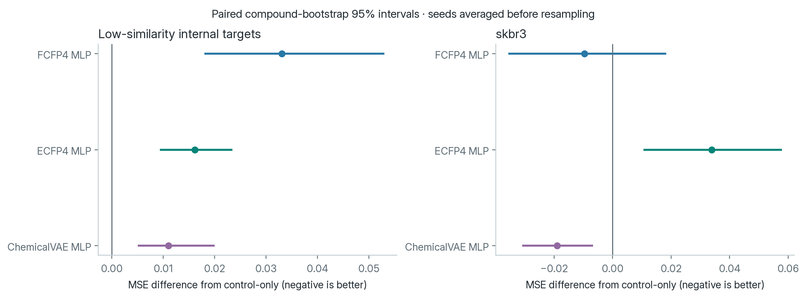
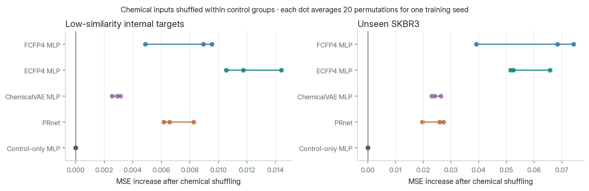
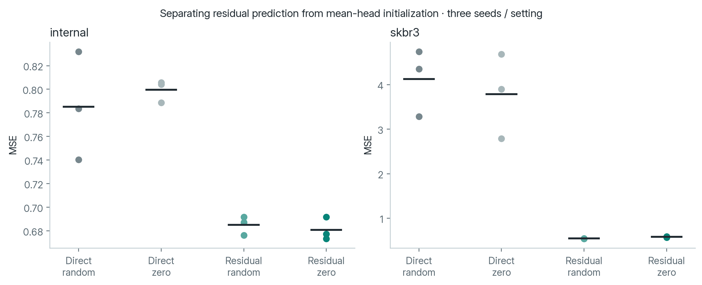
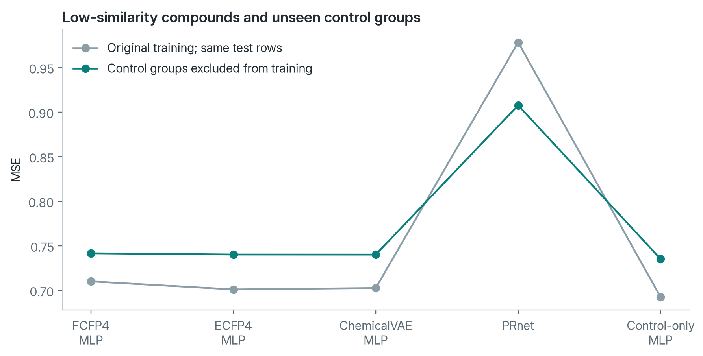
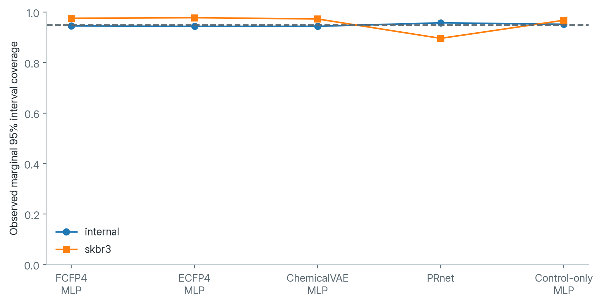

# Supplementary analyses

These analyses complement the selected ECFP4 MLP–PRnet comparison in the [project overview](../README.md). They assess whether chemical inputs add information beyond control expression, whether the architecture or experimental context drives performance, and how sensitive predictions are to control estimation. They do not replace the main comparison, and their results remain part of the project's scientific conclusions.

Shared data preparation, model fitting, metrics and uncertainty calculations are described in [METHODS.md](../METHODS.md). Saved numerical results are available under `extension/balanced`.

## Additional fitted baselines

Unchanged DMSO, used in the main comparison, is the measured mean control expression with no fitted parameters. The baselines below instead learn from the training data.

| Baseline | What it learns | Low-similarity MSE | SKBR3 MSE | External correct / 42 |
|---|---|---:|---:|---:|
| Control-only MLP | A response from control expression, without chemical features | 0.6561 | 0.6198 | 29.7 |
| Global mean response | Mean training treated-minus-control response | 0.7215 | 0.5505 | 26.0 |
| Cell mean response | Mean training response within each cell line | 0.7080 | 0.5505 | 29.0 |
| Linear ECFP4 + control | A ridge-regularized response from ECFP4 and standardized controls | 0.6350 | 1.0404 | 26.0 |

The low-similarity test contains 16,531 profiles from 474 compounds; SKBR3 contains 574 profiles from 137 compounds. Control-only scores average three training seeds. Fractional external counts are averages across runs. Lower MSE and higher correct-direction counts are better.

The control-only MLP uses the same hidden layers, residual prediction, variance head, three seeds and validation-NLL tuning protocol as the chemical MLPs, but omits chemical inputs. Its score must not be described as the unchanged-control score: it is a fitted network.

Global and cell-specific mean responses are estimated from training treated-minus-control targets and added to the measured test control. For an unseen cell line, the cell-specific baseline falls back to the global training response. This explains their identical SKBR3 scores.

Ridge regression uses ECFP4 and train-standardized controls, with an unpenalized intercept. Validation MSE selects regularization from 0.0001, 0.001, 0.01 and 0.1. Its objective is mean squared residual error plus the regularization coefficient times the squared coefficient norm. This selection criterion differs from the probabilistic networks' validation NLL. No baseline fits on held-out targets.

The linear model outperforms all three chemical MLPs on distant compounds. The training mean response is strongest on SKBR3. Control-only also has lower distant-compound MSE than each chemical MLP and the highest mean external count among the fitted networks. These findings limit any claim that beating PRnet demonstrates added predictive value from chemical encoding or network complexity.

Sources: [low-similarity scores](../extension/balanced/summary/low_similarity_seed_scores.csv), [model summary](../extension/balanced/summary/model_summary.csv), [external seed counts](../extension/balanced/summary/external_seed_counts.csv), [baseline protocol](../extension/balanced/baseline_protocol.json).

## Chemical information: dependence and benefit

*Differences in MSE from the control-only MLP, with descriptive 95% paired compound-bootstrap intervals. Negative values favor the chemical MLP. Losses are averaged across training seeds before compounds are resampled.*

All three chemical MLPs have higher MSE than control-only on the low-similarity subset. ChemicalVAE improves on control-only in SKBR3, but does not outperform the simpler training mean response. The intervals use 4,000 compound-cluster bootstrap draws. Additional control-group intervals are retained; neither separate analysis fully models crossed compound/group dependence.

*Chemical features are permuted within matched control groups. Controls, treated targets and PRnet decoder draws stay fixed. Points summarize technical permutations, not new biological experiments.*

| Model | Low-similarity MSE increase | SKBR3 MSE increase |
|---|---:|---:|
| FCFP4 MLP | 0.00778 | 0.06065 |
| ECFP4 MLP | 0.01223 | 0.05660 |
| ChemicalVAE MLP | 0.00287 | 0.02453 |
| PRnet | 0.00700 | 0.02431 |
| Control-only MLP | 0.00000 | 0.00000 |

There are 20 chemical-input permutations per dataset and selected model seed. For the low-similarity summary, only target rows are restricted; permutation donors come from the full internal test control group. Control-only predictions must remain exactly unchanged. A shuffling penalty shows dependence on the chemistry-response association under this intervention. It does not establish a causal mechanism or improvement over a separately fitted baseline. Groups with only one compound cannot provide an informative within-group permutation.

Sources: [paired MSE intervals](../extension/balanced/summary/paired_mse_intervals.csv), [permutation summaries](../extension/balanced/diagnostics/permutation_seed_means.csv), [diagnostic protocol](../extension/balanced/diagnostics/protocol.json).

## Residual prediction and initialization

*The 2 × 2 experiment crosses direct versus residual prediction with random versus zero mean-head initialization. Points are training seeds; bars show means.*

All four combinations use ECFP4, three seeds and shared fixed fitting settings. This separates the prediction rule from initialization. These fixed-setting fits are distinct from the validation-tuned main comparison, so their scores should not be pooled with the main validation-selected results.

Source: [factorial ablation summary](../extension/balanced/summary/factorial_ablation.csv).

## Holding out control groups as well as compounds

The original internal test contains close chemical analogues and extensive control-group reuse. Specifically, 27,752 of its 27,765 profiles have a matched control group also used by training profiles. Shared controls do not automatically leak treated targets, but they limit the independence of the evaluation.

A secondary split removes about 20% of control groups within training cell lines from fitting and validation, then evaluates original test compounds in those groups. Original compound assignments are preserved. This leaves 168,883 training, 20,194 validation and 5,574 test profiles. Control standardization is refitted using the reduced training set.

*The two conditions use identical low-similarity joint-holdout test rows: 3,211 profiles from 440 compounds. One retains the original training cohort; the other removes selected control groups from fitting and validation. Both use shared fixed fitting settings, not the main tuned settings.*

The stricter subset has maximum ECFP4 Tanimoto similarity at most 0.7 to the original training cohort and therefore also satisfies that threshold against the reduced cohort. No additional fit is needed to score this subset. The reduced training size is a second change, so a performance difference cannot be attributed solely to control-group reuse. Control groups are not necessarily whole detection plates, and this experiment is not a scaffold-disjoint test.

Sources: [model summary](../extension/balanced/summary/model_summary.csv), `extension/balanced/results/`, [group-holdout implementation](../extension/group_holdout.py).

## Actual control replicates and predictive intervals

Synthetic control noise is part of the main project objective. A complementary analysis resamples actual DMSO measurements: 20 half-control subsets are drawn without replacement per plate, retaining at least one control. Each subset is used by every selected model seed and unchanged DMSO while treated targets remain fixed. With half the controls, mean ECFP4 SKBR3 MSE is 0.6737, compared with 0.6537 using all controls. This measures sensitivity to this specific control-estimation procedure.

*Coverage is the proportion of measured profile-gene values inside a nominal 95% predictive interval. An interval close to 95% coverage can still be uninformative if it is too wide.*

| Model | Original internal 95% coverage | SKBR3 95% coverage | SKBR3 NLL |
|---|---:|---:|---:|
| FCFP4 MLP | 94.5% | 97.6% | 0.180 |
| ECFP4 MLP | 94.4% | 97.8% | 0.233 |
| ChemicalVAE MLP | 94.4% | 97.3% | 0.190 |
| PRnet | 95.8% | 89.6% | 0.952 |
| Control-only MLP | 95.2% | 96.8% | 0.207 |

Intervals use predicted mean ± 1.96 standard deviations. PRnet uses a Gaussian moment approximation with total mixture variance for the interval; its NLL instead uses the log of the average marginal density across 32 decoder draws. Lower NLL is preferred. Coverage is marginal, not simultaneous across all 978 genes, and does not express confidence in a causal drug effect.

Sources: [empirical control resampling](../extension/balanced/diagnostics/empirical_control_resampling.csv), [model summary](../extension/balanced/summary/model_summary.csv), [calibration implementation](../extension/calibration.py).

## SKBR3 repeatability reference

A leave-one-profile-out reference averages other test treatment responses for the same compound. Across 568 eligible SKBR3 profiles, its MSE is 0.4669, versus 0.5516 for unchanged DMSO on those same rows. This suggests repeatable signal among measured replicates, but the reference uses test treatment information. It is not a deployable predictor, a trained model or a guaranteed noise ceiling.

SKBR3 also includes compounds observed in other training cell lines. [Compound-exposure summaries](../extension/balanced/summary/skbr3_compound_exposure_results.csv) separate this issue from cell-line transfer.

## Additional external checks

The external panel has seven study clusters, not 42 independent experiments. The six genes in each study stay together when uncertainty is calculated. All chemical-MLP versus PRnet descriptive 95% intervals span zero. Control-only has the highest mean correct count among the five fitted networks, but its interval against PRnet also spans zero.

A training gene-direction vote gives 26/42 correct directions; always predicting down gives 25/42. These contextual references help interpret a score obtained on a small, unbalanced panel. Unchanged DMSO predicts no direction and is not assigned a zero-accuracy classification score.

The observed-label sensitivity analyses retain 27 directions with separated treated/control replicates, and 15 that additionally have an absolute mean log-expression change of at least 0.5. These are descriptive rules, not formal differential-expression tests. An inconclusive contrast does not establish biological equivalence or an unchanged gene. The project does not validate a calibrated three-way up/down/unchanged decision.

Sources: [external label sensitivity](../extension/balanced/summary/external_label_sensitivity.csv), [paired study-bootstrap intervals](../extension/balanced/summary/paired_external_intervals.csv), [external counts](../extension/balanced/summary/external_seed_counts.csv).

## PRnet source-recipe sensitivity run

A separate PRnet run in `extension/reference` follows a source-recipe configuration with different expression preprocessing. It uses seed 42, was trained for 110 epochs and selected epoch 88. Its dose-matched evaluation averages 32 fixed decoder draws and scores 24/42 eligible directions. Run `python extension/evaluate_reference.py` to reproduce that evaluation after restoring the required assets.

This run is not pooled with the main comparison because it uses different preprocessing and only one training seed. Its raw MSE is on a different scale. The 24/38 count retained in its original summary uses the original external labels and one decoder draw and is not directly comparable with the dose-matched 24/42 count.

## Scope of the conclusions

These checks explain why a model's numerical advantage must be interpreted cautiously. Chemical features affect predictions, but their inclusion does not consistently improve on fitted alternatives. Some simple baselines are stronger, evaluation data were reused during development, and the external and cell-transfer evidence is limited. These findings remain visible in the main overview as well as here.

Original data, model and implementation credits are retained in [MLP_PRnet_controls/SOURCES.md](../MLP_PRnet_controls/SOURCES.md), [extension/SOURCES.md](../extension/SOURCES.md) and the corresponding source directories. The [report](REPORT.md) retains the literature references; [DATA.md](DATA.md) describes the assets needed for reproduction.
